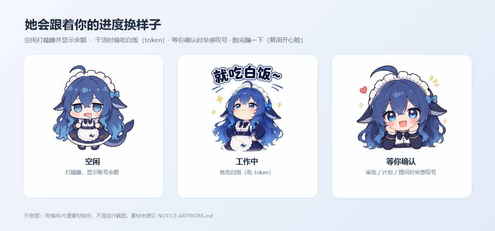
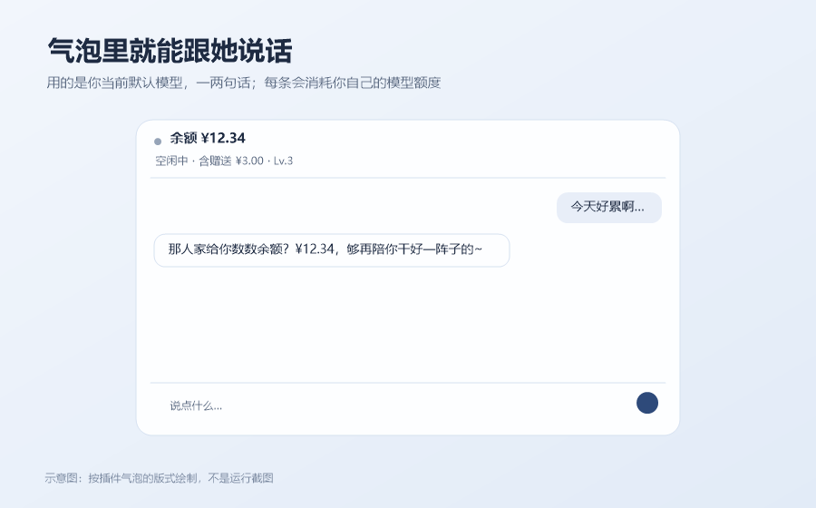
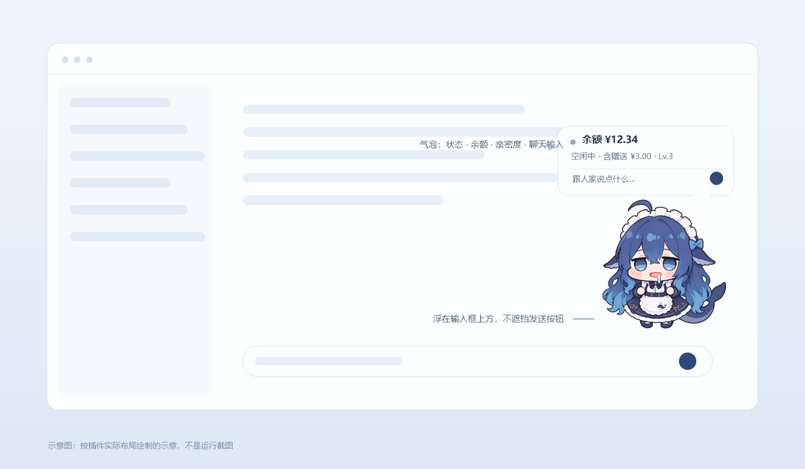

# 深海女仆桌宠 · DSH Whale Pet

> 住在 DeepSeek Harness Web 界面右下角的 Q 版鲸娘桌宠：跟着 Agent 的工作进度换样子，闲下来显示账号余额，还能直接在气泡里跟她聊天。

[](docs/images/states.png)

她是一名 `@local/dsh-whale-pet` 插件（DSH bundle），渲染在 `shell.overlay` 这一层——也就是整个界面之上、所有滚动容器之外的浮层里。

## 功能

### 1. 跟着 Agent 的状态换样子

她只跟随**主视图里那个 Session** 的状态（后台任务、定时任务不会让她一直"工作中"）：

| 状态 | 样子 | 气泡 |
| --- | --- | --- |
| 空闲 | 打瞌睡的 Q 版全身 | `余额 ¥12.34` / `空闲中 · 含赠送 ¥3.00 · Lv.3` |
| 工作中 | 双手叉腰、头顶「就吃白饭～」 | `工作中…` / `偷偷扒饭中（token）` |
| 等你确认 | 开心脸 + 感叹号徽标 | `等你审批` / `等你回答` / `等你确认计划` |
| 刚跑完 | 同一张开心脸，蹦一下 | `跑完啦！` |

"就吃白饭"是字面意思：Agent 干活时在烧 token，她在旁边扒饭。

### 2. 余额

气泡空闲时读取 DeepSeek 账号余额（`account/getBalance`，仅在页面可见时约 90 秒刷新一次），格式和「设置 → 账号」一致（`<¥0.01`、千分位、`-¥12.30`）。未登录显示「未登录」，账号服务或授权不可用显示「余额不可用」。

### 3. 聊天

点开气泡就能在输入框里跟她说话，回复**流式**出现：Host 端一个同源路由把话交给你的默认模型，用桌宠人设回一两句（≤220 输出 token）。模型不可用时她只回一句离线台词。

> ⚠️ 每条消息都会消耗你自己的模型额度；她不能执行命令、读写文件、上网或调用工具，只看得见气泡里显示的状态和余额。聊天记录只存在页面内存中，刷新即清空。

[](docs/images/chat.png)

### 4. 可互动

- **摸摸**：气泡展开时点她，头 / 身体 / 尾巴反应不同，+1 亲密度，有专属抖动
- **投喂**：气泡右上角 🍰，+3 亲密度、每 2 分钟一次（冷却中再点她会说"刚吃过"）
- **亲密度**：升级时蹦一下并道谢，等级显示在气泡第二行
- **拖起放下**：拖动时她会说话（气泡展开状态下）
- **自言自语**：空闲时每 75–150 秒嘀咕一句；余额低于 10 会念叨
- **跟随指针**：朝鼠标方向轻轻偏头（系统开启"减少动态效果"时不偏）
- **位置记忆 / 双击归位 / 方向键微调 / ✕ 或 Esc 收起**

### 5. 界面细节

- 浮在输入框和「回到底部」按钮上方，不挡发送按钮；窗口窄于 560px 自动隐藏
- 气泡在靠近屏幕顶部时自动翻到下方
- 点击/滚动只作用于她自己与气泡，不会穿透到后面的界面
- 只用 `--dsw-alias-*` 语义色，深浅主题自动跟随；尊重 `prefers-reduced-motion`
- 键盘可达：Tab 到本体、方向键微调、Esc 收起；互动反馈走独立的 `aria-live` 区域（不会把自言自语灌给读屏器）

[](docs/images/ui-preview.png)

## 安装

**要求**：DeepSeek Harness（Web profile）。开发与验证是在 `0.2.2-rc.5` 上完成的。

### 方式一：插件页安装（推荐）

1. 把整个目录放到任意位置（例如 `~/.dsh/plugins/dsh-whale-pet`）
2. 打开 DSH Web → 设置 → **插件** → **添加插件** → 选择该目录
3. 到 Session 里看一眼右下角，或直接刷新页面

等价的命令行方式（在 DSH 会话里让 Agent 调用 `plugin_manager`）：

```
install_bundle(target: "<absolute path to this directory>")
```

### 方式二：手工写进 profile 的 patch

```yaml
- insert:
    - id: whale-pet
      name: '@local/dsh-whale-pet'
```

## 首次使用要注意

- **余额**需要账号已登录；用 API Key 跑的话会显示「未登录」
- **聊天**会在 Host 端调用你当前默认模型，消耗额度
- 位置、气泡开合、亲密度都存在浏览器 `localStorage`（`dsh.whale-pet.*`），不是账号数据
- 首次加载会拉三张 PNG（约 450 KB 合计）

## 可调参数

| 位置 | 常量 | 作用 |
| --- | --- | --- |
| `client.js` | `--whale-pet-size`（CSS） | 桌宠尺寸，默认 120px |
| `client.js` | `right` / `bottom`（CSS） | 默认停靠位置 |
| `client.js` | `BALANCE_POLL_MS` | 余额刷新间隔，默认 90s |
| `client.js` | `IDLE_MIN_MS` / `IDLE_MAX_MS` | 自言自语间隔 |
| `client.js` | `PET_POINTS` / `FEED_POINTS` / `FEED_COOLDOWN_MS` / `levelOf()` | 亲密度规则 |
| `index.js` | `PERSONA` | 聊天人设提示词 |
| `index.js` | `MAX_OUTPUT_TOKENS` / `RATE_LIMIT` / `MAX_INPUT_CHARS` | 聊天上限与限流 |

**换图**：资源路由带 immutable 缓存、ETag 只取路径，所以**不能用同名覆盖**——新图必须换文件名（约定 `<名字>-<内容哈希前12位>.png`），再改 `client.js` 里的 `POSE_FILES`。

## 目录结构

```
dsh-whale-pet/
├── package.json          # bundle 清单（dsh.bundle / dsh.client / exports）
├── cordis.patch.yml      # 插入 whale-pet 这一行
├── index.js              # Host 半边：同源聊天路由 + 模型调用
├── client.js             # Client 半边：状态机 / 气泡 / 互动 / 样式
├── lib/assets/           # 三张立绘（文件名带内容哈希）
├── locale/               # 插件页文案（en / zh）
├── docs/
│   ├── DETAIL.md, DETAIL.zh.md   # 插件详情（单图文档）
│   ├── preview.svg               # 插件详情页用图
│   └── images/                   # README 示意图
├── icon.svg
├── tools/                # 素材处理脚本（抠图 / 合成 / 画 README 图）
├── NOTICE-ARTWORK.md     # 素材署名与许可
└── LICENSE               # 代码许可（MIT）
```

`tools/` 里的脚本是纯 Node（除 README 配图用 PowerShell + System.Drawing），只依赖标准库，方便复现素材处理过程；它们不参与插件运行时。

## 许可与素材

- **代码**：MIT，见 [LICENSE](LICENSE)
- **形象素材**：三张立绘的授权**各不相同**，详见 [NOTICE-ARTWORK.md](NOTICE-ARTWORK.md)
  - 空闲、等你确认：来自社区作品「鲸鱼娘 · 深海女仆工坊」（原作 上善无形，素材由 Small-tailqwq 发布），**CC BY-NC-SA 4.0 —— 仅限非商业用途**
  - 工作中那张：**由作者本人提供，来源与授权未核实**。若要公开发布，请先确认权利，或换成 `NOTICE-ARTWORK.md` 里提到的替代素材

> 本项目是社区插件，与 DeepSeek 官方无关；"DeepSeek"、"DeepSeek Harness" 等名称归其权利人所有。

## 已知限制

- 没有浏览器截图能力时无法自动化视觉回归；`docs/images/` 里的图是**按插件版式绘制的示意图**，不是运行截图
- 聊天接口是给同源页面用的：校验 `Origin` / `Host`、只收 `application/json` POST、限流 8 次/30 秒；本地进程若直接调用仍可触发（同一台机器上本就信任该边界）
- 桌宠是浮层，右侧面板打开时会盖住其一小块内容，长草稿也可能顶到她下方
